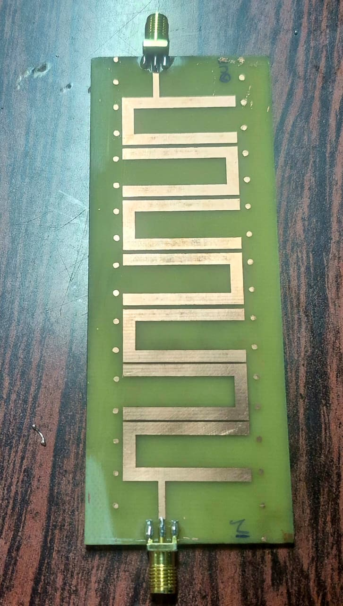

# 1.42 GHz Microstrip Hairpin Band-Pass Filter for a 3 m Radio Telescope



Design, fabrication, and bench verification of a **7th-order microstrip hairpin
band-pass filter at 1.42 GHz** — the frequency of the 21-cm hyperfine line of
neutral hydrogen — built as the receiver front-end filter of a 3 m automated
radio telescope at Fergusson College (Autonomous), Pune.
*(A first-author manuscript on this work is in preparation.)*

## Results (Rohde & Schwarz ZVH8 vector network analyzer)

| Metric | Measured |
|---|---|
| Passband plateau | −10 to −12 dB across ≈ 1.3–1.45 GHz |
| In-band reflection | dips deeper than −20 dB |
| Stopband rejection | ≈ −77 dB |

## Design chain
1. **Synthesis** — Chebyshev low-pass prototype → hairpin band-pass via external
   quality factors (Qₑ) and inter-resonator coupling coefficients (k).
2. **Simulation** — full electromagnetic geometry in MATLAB (RF Toolbox);
   S-parameters extracted; layout exported to **KiCad**, Gerbers generated.
3. **Fabrication** — PCB milled/etched on **FR-4**.
4. **Verification** — VNA measurement; the passband shift vs. the design target
   was traced to **FR-4 dielectric-constant tolerance** — a practical lesson in
   how substrate uncertainty propagates through a real instrument.

## Repository layout
```
├── matlab/                 # design & simulation scripts (MATLAB RF Toolbox)
├── figures/                # layout, S-parameter plots, fabricated board photos
├── data/                   # measured S-parameter data (if provided)
└── README.md
```

## Key figures
| Figure | What it shows |
|---|---|
| `hairpin_layout.png` | synthesized hairpin layout (KiCad/Gerber view) |
| `Figurebandpass_S21.png` | measured transmission (passband plateau) |
| `Figurebandpass_S11.png` | measured reflection (in-band dips) |
| `Hairpin_fabricated.jpeg` | the fabricated board |

## Skills demonstrated
RF/microwave filter synthesis · electromagnetic simulation · PCB design
(KiCad/Gerber) · fabrication · VNA measurement · interpreting model-vs-reality
deviations.

---
*Author: Roshani Devendra Naik ([@roshninaik49649-blip](https://github.com/roshninaik49649-blip)) ·
Thesis work, Department of Physics, Fergusson College (Autonomous), Pune — adviser: Dr. Manish S. Hiray.*
